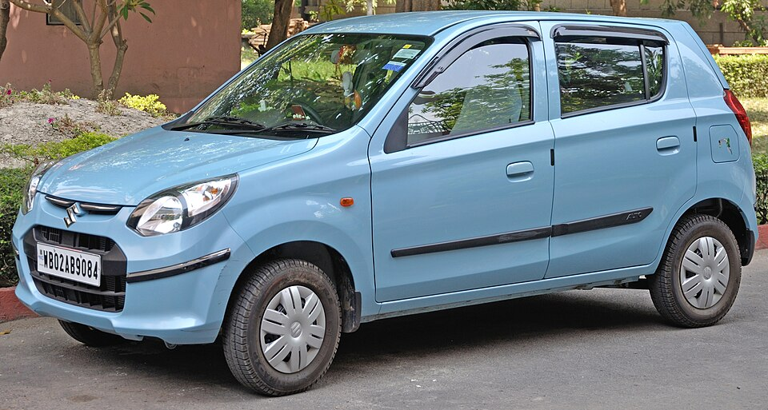

# SwiftDrive Rentals — Car Rental Operations Platform

**SwiftDrive Rentals** is a PHP/MySQL web application demonstrating vehicle discovery, availability queries, reservation requests, fleet administration, staff pickup/return inspections and customer self-service in a Sri Lankan rental-business scenario.

> **Portfolio demonstration, not a live rental agency.** The published SQL contains a schema and wholly synthetic vehicle, user and pricing examples; the original customer, booking, payment, inquiry and inspection records were excluded.

## Features implemented in the source

| Area | Scope |
| --- | --- |
| Visitors | Vehicle catalog, vehicle details, availability search and contact form |
| Customers | Registration, booking requests, booking history, payment-oriented UI and profile |
| Operations staff | Booking workflow, pickup/return inspections and inquiry handling |
| Administrators | Vehicle/fleet management, customer and staff tools and operations views |
| Server | PHP 8.x, PDO, role-aware sessions, CSRF helpers and reservation pricing logic |
| Database | MySQL/MariaDB relational schema with fictional test fixtures |

### Vehicle gallery assets from the project

| Economy | SUV | Premium |
| --- | --- | --- |
|  |  |  |

*These are checked-in vehicle image assets, not screenshots of a tested website or listings for real rental vehicles.*

## Local setup

**Requirements:** PHP 8.3+ with PDO MySQL, Apache/MAMP/XAMPP, MySQL 8+/MariaDB.

1. Import **sql/swiftdrive_rentals.sql** into a local MySQL instance. The file recreates the schema and seeds synthetic people/vehicles only; avoid importing it into a database containing important data.
2. Configure the database using the defaults in **config/config.php** or create a private **config/config.local.php** based on the supplied example (excluded from Git).
3. Start a local PHP web server from the project root, or place the project inside an Apache document root.

~~~bash
php -S 127.0.0.1:8081
~~~

4. Open http://127.0.0.1:8081. The local MAMP example config can supply port 8889 for MySQL if that is where your database runs.

### Synthetic local demo accounts

| Role | Email | Password |
| --- | --- | --- |
| Administrator | admin@example.test | DemoAdmin123! |
| Staff | staff@example.test | DemoStaff123! |
| Customer | customer@example.test | DemoCustomer123! |

**Do not run published demonstration credentials on a public deployment.** Passwords and rates in this example are not commercial production settings.

## Verification

~~~bash
find . -type f -name '*.php' -print0 | xargs -0 -n1 php -l
~~~

**29 PHP files** passed syntax checking with PHP 8.5.2. A complete database-backed browser test, payment reconciliation and fleet acceptance test have not been established.

## Explore the project

- [Technical architecture and booking flow](docs/ARCHITECTURE.md)
- [Engineering case study, decisions and known limitations](docs/CASE_STUDY.md)

## Limitations and licensing

The code includes a payment-oriented demonstration workflow; it is **not evidence of actual gateway settlement**. The source includes vehicle photography whose external reuse rights were not independently verified; confirm rights before commercial use. No real customer or vehicle registration records have been published.
